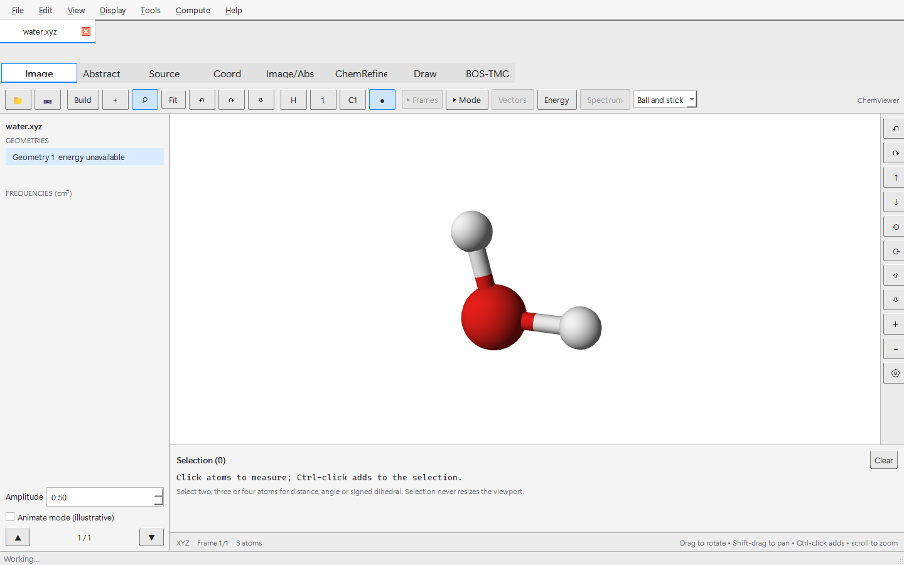

# ChemViewer

Windows-first native Qt desktop work is underway on the development branch. Its
workspace has been rebuilt to follow the native Apple layout while retaining the
shared Swift scientific core.
See [desktop build, controls and acceptance checks](docs/windows-desktop.md).
The released 0.12.0 portable viewer remains distinct from this desktop port.

Molecular visualization and computational chemistry workflows for macOS, with a
shared-parser portable viewer preview for Windows and Linux.

**[Feature guide](docs/user-guide.md) · [Windows/Linux quick start](docs/portable-viewer.md) · [Testing and releases](docs/release-process.md) · [Feature status](docs/feature-parity.md)**



Released version **0.12.1** prepares the project for 1.0. The native Mac app retains its
full existing interface; the portable viewer currently covers molecular viewing,
trajectories, modes, source inspection, energy plots and XYZ/JSON/PNG export.
Cross-platform editing, ChemRefine/SSH/BosTMC UI parity and physical Windows/Linux
acceptance remain required before calling this a cross-platform 1.0 release.

This repository is an independent implementation of practical ChemCraft
workflows. It does not contain ChemCraft code, assets, license material, or
decompiled source. The Windows application is treated only as a behavioral and
file-compatibility reference.

## Current working slice

- Persistent remote SSH file explorer and independent document tabs.
- ORCA Cartesian input and explicit XYZ companion reading.

- Native SwiftUI macOS interface with a calculation, geometry, and frequency tree.
- Metal renderer for element-colored atoms and inferred bonds.
- Mouse and right-drag rotation, Option-drag panning, and scroll zoom.
- Multi-frame XYZ parsing, including element symbols or atomic numbers.
- ORCA text-output parsing for Cartesian geometries, final energies,
  vibrational frequencies, normal-mode displacement vectors, and IR intensity.
- Normal-mode animation with imaginary frequencies highlighted in red.
- Optional scaled normal-mode arrows in the Metal viewport.
- Editable Cartesian coordinate table with geometry undo.
- Click/Shift-click atom selection with distance, angle, and signed-dihedral readouts.
- Multi-frame trajectory play/pause at the Windows reference default interval.
- Interactive IR stick spectra with Gaussian or Lorentzian broadening.
- Background parsing so large text files do not block the UI.
- Swift unit tests plus an independent Python regression oracle.

This is an expanding independent implementation rather than full feature parity.
The released-feature sections below and `docs/feature-parity.md` record supported
behavior, validation evidence and remaining gaps.

## Build on Apple Silicon

Requirements: macOS 13 or later and a Swift 5.9+ toolchain (Apple Command Line Tools or full Xcode).

```bash
cd ~/Documents/software/ChemViewer
bash scripts/build-macos.sh
open dist/ChemViewer.app
```

To build and update the installed app in one command:

```bash
bash scripts/install-macos.sh
```

This updates `/Applications/ChemViewer.app` and any existing `~/Applications/ChemViewer.app` copy, so existing shortcuts open the current version. Quit and reopen ChemViewer after updating; no Finder dragging is needed. After an already validated build, use `bash scripts/install-macos.sh --no-build`. The script does not close the running app or discard unsaved work.

The script runs XCTest when full Xcode is selected. On Command Line Tools-only Macs it instead runs the checked-in core regression assertions through an explicitly standalone runner (not XCTest). CI requires genuine XCTest with `--require-xctest`. It then builds an ARM64 executable, creates a conventional
`.app` bundle, copies SwiftPM resources, applies an ad-hoc local signature, and
verifies the bundle. Distribution outside the development machine will require
an Apple Developer ID signature and notarization.

## Private GitHub build artifact

`.github/workflows/macos.yml` runs on a native Apple Silicon `macos-15`
GitHub-hosted runner. On every push to `main` (or a manual dispatch), it runs
the Swift tests, builds and verifies `ChemViewer.app`, and uploads
`ChemViewer-macos-arm64.zip` as a 30-day workflow artifact. See
`docs/github-delivery.md` for the download, signing, and Gatekeeper boundary.

CI validates compilation and noninteractive tests only. Metal appearance,
Finder opening, gestures, and other interactive behavior must still pass
`docs/macos-gui-acceptance-tests.md` on the physical Mac.

The private repository is `https://github.com/ignaciomigliaro/ChemViewer`.
Apple Silicon run `38922066239` passed all seven Swift tests plus the arm64,
bundle-signature, packaging, and artifact-upload checks. Download its
`ChemViewer-macos-arm64` artifact from the repository's **Actions** page.

## Tests and branch policy

Every push, pull request and merge-queue candidate runs the all-platform workflow.
The required `release-gate` depends on Swift XCTest, per-module coverage floors,
Python scientific regressions, migrated geometry suites, portable executable and
browser acceptance, and Mac/portable packaging. Main requires a pull request and
passing up-to-date checks; force pushes and deletion are disabled.

```bash
swift test --enable-code-coverage
python -m pip install -r requirements-test.txt
python -m coverage run -m unittest discover -s python_tests -v
python scripts/check-building.py
python scripts/check-portable.py --binary .build/debug/ChemViewerPortable
python Tests/gui/desktop/test_desktop.py
```

Use the `.exe` binary suffix on Windows. POSIX transport/engine Python tests run
on Linux and macOS; Windows runs the shared core, executable and browser gates.
Licensed reference corpus checks are optional and explicitly skipped when absent;
redistributable synthetic fixtures run everywhere. See [complete validation and
release instructions](docs/release-process.md), including physical GUI requirements.

## Official-macOS diagnosis

The current official b638m ARM and Intel DMGs were downloaded and statically
inspected. Both are Lazarus LCL/Cocoa applications with only Apple system
dependencies. The ARM binary is ad-hoc/linker-signed without a certificate or
hardened runtime; Intel is unsigned. No target-Mac crash report or live launch
evidence is available yet. On the target Mac, run:

```bash
bash scripts/collect-macos-diagnostics.sh /Applications/Chemcraft.app
```

The script is read-only: it records architecture, code-signing, Gatekeeper,
quarantine attributes, linked libraries, load commands, hashes, and recent
ChemCraft crash reports. It does not clear quarantine or change security
settings. See `docs/macos-diagnostics.md`.

## Documentation

- [Feature guide](docs/user-guide.md) — task-oriented instructions for every implemented feature family.
- [Portable viewer](docs/portable-viewer.md) — Windows/Linux setup, illustrated workflows and limits.
- [Windows desktop](docs/windows-desktop.md) — native shell, controls, validation and remaining parity work.
- [Release process](docs/release-process.md) — branch policy, CI coverage and 1.0 acceptance.

- `docs/architecture.md` — modular design and implementation decisions.
- `docs/windows-feature-inventory.md` — reference functionality and evidence.
- `docs/windows-gui-audit.md` — direct Windows GUI observations and incidents.
- `docs/gui-feature-inventory.md` — observed controls and workflow status.
- `docs/macos-gui-acceptance-tests.md` — Apple Silicon release checks.
- `docs/macos-diagnostics.md` — current diagnosis and target-Mac procedure.
- `docs/reverse-engineering-findings.md` — observation/inference ledger.
- `docs/feature-parity.md` — implementation and test status.
- `docs/scientific-validation.md` — units, fixtures, tolerances, and results.

## Legal boundary

Use only legally obtained ChemCraft builds and files. Do not commit or
redistribute ChemCraft executables, proprietary databases, registration data,
or recovered source. Do not bypass licensing or access controls. Test fixtures
added to this repository must be independently generated or redistributable.

## Local Mac validation (2026-10-19)

The app now builds on the user's Command Line Tools-only ARM64 Mac. Run `bash scripts/build-macos.sh`, then `open dist/ChemViewer.app`. Full Xcode is required for `swift test`, but not for this local build-and-check path.

The packaged app has an opt-in integration check:

```bash
dist/ChemViewer.app/Contents/MacOS/ChemViewer --smoke-test
```

This opens a test window, checks the actual Metal shader pipelines and completed GPU frames, XYZ opening/export, coordinate undo, selection, negative-mode loading, animation and pause, then exits. It does not replace human checks of visual fidelity, gestures and native file dialogs. See `docs/mac-validation-2026-10-19.md` for results and limits.

### Updated molecular view (0.2.0)

Use Image / Abstract / Source / Coord / Image/Abs (Cmd+1…5) to switch between the molecule, parsed summary, original output, editable coordinates and split view. Display offers Publication, Soft spheres, Large spheres and Sticks. The camera icon exports a PNG of the current viewport. The Publication and Soft palettes are inspired by [xyzrender](https://github.com/aligfellow/xyzrender); its MIT notice is included with the app. Rendering is native Metal. This update does not establish full Chemcraft feature parity; see [validation and limits](docs/rendering-and-ui-2026-10-19.md).

### Energies, plots and molecular edits (0.3.0)

Abstract now pairs geometries with energies/structures and links ORCA SCF/final-energy sections to original output. For unitless XYZ comments, choose the input energy unit there. Arrow keys browse geometries. Left-click toggles unlimited atom selection; two atoms expose distance editing (second only or both equally), three expose angle editing. Undo restores energy together with geometry.

**Energy landscape…** uses Matplotlib for relative/absolute energy profiles, with optional selected distance/angle axes and molecular thumbnails. Export includes vector PDF/SVG, 600-dpi PNG, CSV and a reproducible script. Set up the optional plotting runtime with `bash scripts/setup-plotting.sh` (already installed on the current Mac). See [usage, scientific behavior and validation](docs/energy-and-editing-2026-10-19.md).

### Thermochemistry and dragging (0.4.0)

Right-click clears selection. The hand/Atom/Fragment/Molecule toolbar enables coordinate dragging and ±X/Y/Z rotation/translation with a selectable pivot. Select a bonded pair before Fragment to isolate its second side. Angle editing now offers C-only or symmetric A/C movement about B. Abstract has compact copyable E/H/G rows and electronic-plus-thermal sums; Coord has Copy coordinates and Copy XYZ. See [behavior and validation](docs/thermochemistry-and-manipulation-2026-10-19.md).

### Measurements and smooth interaction (0.5.0)

Select 2, 3 or 4 atoms and enable Show bond length / Show angle / Show dihedral to annotate the molecule and exported PNG. Four selections also expose a signed-dihedral readout. Mouse view rotation follows the grab direction. Local drag previews and cached instanced meshes reduce update overhead; the 500-atom local benchmark's median CPU draw time fell from 17.05 to 1.17 ms. See [validation and scope](docs/measurements-and-smooth-drag-2026-10-19.md).

### Paton appearance and GIF export (0.6.0)

The default drawing style is **xyzrender · Paton**, adapted to the native renderer. Switch appearances in the toolbar or Display menu. Rotate your molecule, then use **File → Export Animation as GIF…** for multi-XYZ/ORCA geometries or the selected normal mode. The GIF keeps your viewing angle and fits the full animation once. Choose size, frame rate and optional forward/backward trajectory playback. See [details and limits](docs/paton-and-gif-2026-10-19.md).

## One app: ChemViewer 0.7.0

MoleculeView's implemented builder, project and classic GUI features are now integrated here. Use **+** or **Cmd-B** for the right-hand builder; **File → New Molecule** starts a structure. Add/import/attach fragments, insert/replace/duplicate/delete atoms, select ranges/groups, transform about axes or a saved bond, Undo/Redo, save projects and export ORCA geometry. Existing `.mvproject` files open in ChemViewer; save new working projects as `.cvproject`. The Paton Metal renderer and every existing analysis/measurement/GIF workflow are retained. **View → Result Explorer** restores left-side trajectory/frequency browsing. See [feature reconciliation and limits](docs/moleculeview-integration-2026-10-19.md).

## 0.7.1 — left explorer restored by default

The geometry/frequency Result Explorer is visible on the left at startup again, as requested. Its geometry selection, per-frame frequency selection and arrow navigation are retained; View → Result Explorer or the sidebar toolbar button still toggles it. The optional right-hand builder remains available with +/Cmd-B. This supersedes 0.7.0’s initially hidden explorer. Verify by opening a multi-geometry ORCA output and browsing geometries and modes from the left panel.

Measurement labels can be repositioned: enable the bond/angle/dihedral overlay, then drag its white label box. Use **Reset label** to restore placement. The moved placement carries into PNG and annotated GIF exports.

The native app icon is bundled at all standard/Retina sizes. Its editable master is Packaging/ChemViewerIcon.png; rebuild it with `bash scripts/build-icon.sh` (also run by the macOS build).

ORCA NEB-TS outputs now open the energy sheet with a reaction-profile option selected: reactant–TS–product levels, forward/reverse barriers, full-band image view, optional structures, and a toggle back to optimization history. Use **Markers** to make PES plots lines only. [NEB plotting details](docs/neb-reaction-profiles-2026-10-19.md).

Versioned releases are checkpointed in Git and pushed to origin after validation, using annotated `vX.Y.Z` tags. The initial cumulative checkpoint for the locally developed 0.3–0.8 features is `v0.8.0`; earlier local builds were not independently tagged.

GIF export defaults to a transparent background (switch it off for white). Atom-number and element captions no longer have white rectangles. GIF transparency is binary; fractional edge opacity cannot be retained.

## Expanded builder and local workflows (0.9.0)

Command-B opens the searchable 258-entry fragment/metal-center library. Choose a fragment, then click a host atom; right-click finishes. Add any element, reuse/save selected fragments, remove unused X sites, and run cancellable UFF cleanup with fixed atoms and undo. **ChemRefine workflow…** opens the real local workflow editor seeded from the current geometry; configure installed engines there. The chemistry runtime is already installed on this Mac. See [usage and validation](docs/building-and-local-workflows.md).

## Popup builder and ChemRefine tab (0.9.1)

Press **Command-B** or **+** to open the fragment preview gallery. Choose a structure, then left-click blank canvas to place it (including in an empty molecule), or an atom to attach it. Right-click finishes. The gallery contains 265 choices including the original templates. **Command-Shift-B** opens editing/UFF controls. **ChemRefine** now has its own main tab (**Command-6**) with the real local workflow editor.

### Building camera fix (0.9.2)

Corrected fragment placement depth so zooming no longer clips newly placed structures away. Zoom is controlled and anchored at the pointer; off-center structures rotate around their own center. The placement banner includes **Fit all**. Existing saved coordinates are preserved; review/rebuild assemblies affected by the earlier placement-depth bug.

### Atom placement and editable elements (0.9.3)

Use **Build → Add Atom…** (Cmd-Shift-A) to open the periodic table. Select
**Replace element** or **Add bonded atom**, then an element and click in the
molecule view. Empty space places a new atom; right-click finishes. Switch modes
in the placement bar. **Build → Fragment Library…** (Cmd-B) retains the fragment
previews. In **Coord**, type an element symbol or atomic number and click
**Apply**; element edits support Undo and preserve coordinates.

### Draw and persistent measurement labels (0.10.0)

Enable a measurement for one selection, then right-click and choose another:
the first label stays visible. Use the **Visible labels** row to select/remove
individual labels or **Hide all**. Labels support dragging and PNG/GIF export.

**Draw** (next to ChemRefine, Cmd-7) provides a native 2D canvas and interactive
3D preview. Draw bonds, choose elements/rings, edit charges, move/erase atoms,
or load SMILES. **Auto 3D preview** uses the installed local RDKit runtime;
**Generate 3D** runs it manually. **Use 3D in Viewer** transfers the generated
structure as an undoable edit. Drafts survive tab switches and can be saved as
JSON. See [usage, tested behavior and limits](docs/drawing-and-labels-2026-10-20.md).

### Centered labels and Run ChemRefine (0.10.1)

Atom captions now sit at sphere centers in the viewer, PNG and GIF. In the
**ChemRefine** tab, use **Check workflow**, **Create missing templates** and
**Install required backends**, then **Run ChemRefine**. The button saves the live
editor and executes the real workflow in the background, with a log and result
folder. Existing input.yaml files can be opened directly.

ORCA is not installed on the current Mac. **Get ORCA** opens its official
installation instructions; after installing the macOS package, use **Choose
ORCA…**. The isolated PySCF backend is installed and was used for a genuine
two-step calculation test. See [setup, execution and validation](docs/chemrefine-execution-2026-10-20.md).

### ChemRefine dashboard controls and energy table (0.10.3)

The bottom-right Run/Resume/recovery controls now use native confirmation sheets
and the same editor-save, readiness/model checks, executable environment and
monitoring as the top Run button. The top panel also provides Resume.
The Run panel includes a live table of every saved step's name, engine, status,
lowest reported energy, energy type, conformer and result count. Choose Eh,
kcal/mol, kJ/mol or eV, and use Copy table for tab-separated results.
Missing energies stay blank; retained results without a successful cache are
marked previous. Different methods' energies are not subtracted automatically.
See [dashboard details](docs/chemrefine-dashboard-2026-10-20.md).

### UMA Python environment (0.10.4)

In ChemRefine, the **UMA Python** row provides **Choose environment**, **Check
Python**, and **Use for UMA steps**. Select an environment folder or bin/python.
The saved default fills missing UMA backend paths; existing overrides remain
unless you explicitly apply it. The Run panel also has editable Python paths
per MLIP step. Paths are saved in input.yaml as options.backend_python, so CLI
ChemRefine uses the same interpreter. [Environment settings](docs/uma-environment-settings-2026-10-20.md).

### Skeletal drawing and rings (0.10.5)

In Draw, **Chain** drags out a zigzag alkane as one undoable edit. Terminal bond
extensions use 120-degree skeletal angles; Option-drag allows other angles.
The toolbar has benzene and saturated ring icons; **More rings** opens 14 visual
templates including unsaturated rings, pyridine, pyrrole, furan and thiophene.
Formal charge tools are under **More**. [Details and validation](docs/skeletal-drawing-2026-10-20.md).

### Draw preview refresh (0.10.6)

Auto 3D preview explicitly shows waiting/generating/error states and rebuilds
after a short drawing pause. Clearing the canvas removes the old 3D structure.
Successful results get a new preview geometry ID so changed structures with the
same atom count are refitted. Stale geometry is dimmed and cannot be transferred;
failed generation shows a prominent error with Retry 3D. Correcting the drawing
retries automatically when Auto 3D preview is on.

## Remote files and SLURM — 0.10.7

Open **File → Remote files & SLURM…** (Cmd-Shift-O), or **Remote / SLURM…**
in ChemRefine. Save independent connection profiles with an SSH alias,
starting directory, remote Python executable **or environment folder**, and
optional Bash environment commands. Authenticate in Terminal for interactive
cluster login; ChemViewer reuses its private OpenSSH connection for up to eight
hours. Existing SSH config handles users, ports and jump hosts. No passwords or
private keys are stored in the app.

Browse/double-click folders and open output/XYZ files directly in the viewer.
Their contents transfer automatically into a local cache; **Refresh remote
file** retrieves updates. This is SSH transfer with automatic caching, not a
remote filesystem mount. Individual files have the existing 100 MB viewer limit;
companion files are not recursively synchronized.

Select `input.yaml` and **Use workflow**, or **Upload workflow inputs…** from a
dedicated local input folder. Upload creates a new remote folder, never merges
into existing calculations, excludes hidden/default outputs/scratch directories,
and supports YAML/XYZ/INP/Python/header/JSON/text inputs (100 MB / 2,000 files).
Use **Edit text…** to configure remote executable/Python paths, `dispatch: slurm`
and cluster CPU/GPU headers, then explicitly save. Paths/dependencies outside the
uploaded folder must already exist remotely. Automatic Mac-path rewriting and
remote dependency installation are not performed.

**Check workflow**, **Run on SLURM…**, **Resume** and **Refresh status** use the
remote ChemRefine API. Its detached controller submits per-step SLURM jobs;
closing the viewer does not stop them. Optional Auto refresh polls every ten
seconds while this window is open. Status includes failure/survivor counts, log
tail and the first 20 actual conformer energies per step in Hartree; Copy step
results preserves a TSV table. Scheduler account, partition, time and compute-node
environment activation belong in the workflow headers. Run asks for confirmation
because it can invalidate cached results; Resume continues a previous run.

See [remote connection validation](docs/remote-connections-2026-10-20.md) for
verified scope and remaining live scheduler validation.

## Faster remote browsing — 0.10.8

The SSH browser now keeps one SSH channel **and one remote Python helper** alive
between folder changes. Changing folders no longer launches another remote
command or repeats environment setup. Recent folder listings are cached for two
minutes; **Refresh folder** retrieves current contents. Directory sizes are not
fetched during navigation, reducing metadata work on cluster storage.

The footer shows connection reuse and request timing. **Disconnect** closes this
app's helper channel; it leaves detached ChemRefine jobs and the shared SSH
authentication session alone. Network/authentication expiry can still require
reconnection, but ordinary folder changes reuse the existing channel.

A read-only packaged-app test on ORCD measured 1,282 ms for the initial request,
11 ms for the next uncached request on the same remote process, and under 1 ms
for a cached return. These are individual home-directory measurements, not a
guarantee for every folder or server load.

## Remote explorer and document tabs — 0.10.9

After connecting/browsing once, **Remote Files** stays in the main window's left
sidebar. Expand folders and click `.xyz`, `.out`, `.log` or ORCA `.inp`/`.in`
files to open them directly. The geometry/frequency explorer remains below it.
The gear opens connection/SLURM settings; normal file navigation needs no modal.
**View → Remote File Explorer** shows/hides it; Go changes the root folder,
Refresh reloads its listing and Show all files exposes workflow/template files.

Each opened file gets a document tab above Image/Abstract/Source/etc. File → Open
accepts multiple files. Selecting an already-open local/remote file activates
its existing tab. Camera, zoom, labels, selection, geometry edits/undo and drawing
state are isolated. X or Cmd-W closes a tab, with a save/discard guard for modified
geometry/drawings. Project saves preserve original calculation/input files.

Loaded Image documents share one active Metal renderer. Inactive normal playback,
trajectory timers and automatic drawing-preview work stop; detached views release
renderer/text resources. Parsed data and undo history stay in memory for fast
switching, and closed documents explicitly clear their data. This reduces idle
CPU/GPU work; it does not unload every inactive document or restore tabs after quit.
Explicit calculation/export jobs retain their independent execution lifetimes.

ORCA input reading supports ordinary `* xyz` Cartesian blocks (Angstrom or Bohr),
charge/multiplicity and explicit `* xyzfile` companions. Remote companions are
fetched through the same SSH session and mapped to their own caches without
rewriting source paths/files. Templates with no coordinates and internal/%coords
forms open as original Source with a limitation message. Expressions, annotated
atom rows and Bohr xyzfile companions are not converted; unsupported/malformed
forms produce a clear message. Multiple Cartesian blocks are read as geometries,
with a warning that tab charge/spin describe the first block. No input energies
are inferred. Format reference: [ORCA coordinate manual](https://www.faccts.de/docs/orca/6.1/manual/contents/essentialelements/coordinates.html).

See [workspace validation](docs/document-workspace-2026-10-21.md) for native, parser
and live remote evidence and the supported scope.

## Remote explorer fix — 0.10.10

The sidebar waits for an ongoing connection request before loading and reloads
after connection changes. All files are visible by default; Home/Parent buttons,
a minimum folder-list height and explicit loading/empty/filter hints make
navigation clearer. Quit and reopen the installed app to use the update.

## Unified SSH / ChemRefine — 0.10.11

Connect from **SSH connection…**, then use the **ChemRefine** tab. The **Run on**
selector offers **This Mac** and **SSH / SLURM · host**; a newly established SSH
channel selects the remote destination automatically. You can switch back to
This Mac explicitly.

In SSH mode, **Open workflow…** selects cluster YAML files and **New from
structure…** selects a cluster parent directory. New workflows have relative
structure/template paths and `dispatch: slurm`; set cluster ORCA/MLIP paths and
review the generated SLURM header for account, partition, time and environment
setup. **Check workflow**, **Run on SLURM**, **Resume** and **Refresh status** live
in this tab. **More → Upload local workflow inputs…** transfers an existing Mac
workflow to a new remote folder and opens it for editing.

The full remote ChemRefine GUI runs through a private loopback SSH tunnel, so
its file buttons, template editor and saving access the cluster filesystem.
It requires `chemrefine[gui]` in the configured remote Python environment.
Closing the editor stops its own GUI process; submitted calculations have an
independent lifetime. A lost tunnel shows a reconnect message. Existing local
editor/run controls remain separate and available.

## Remote editor stability and explorer navigation — 0.10.12

Fixed a false disconnect: OpenSSH's shared connection owns a successfully created
port forward, even after its setup command exits. The editor now waits for a
successful forwarding acknowledgement and monitors its GUI session instead.
Closing the editor explicitly cancels only its own loopback binding.

In the remote explorer, use the dropdown beside **Show all files** to choose
**Name** or **Extension** sorting. Folders stay first; extensions are grouped
without regard to case and numbered names sort naturally. Your choice is saved.
Double-click a folder name to enter it; its disclosure arrow still expands the
folder tree. Home and Parent return to other locations using the existing channel.

## BOS-TMC catalyst screening — 0.11.0

Open **BOS-TMC** to screen a BOS-TMC property CSV on **SSH / HPC** or **This Mac**.
For HPC data, connect using **SSH settings…**, browse to the CSV, and set **Root**
to the directory containing `singlets`, `doublets`, `triplets`, `quartets`,
`quintets`, and `sextets`. Click **Index CSV**. An optional **Index cache** path
places the rebuildable SQLite index on a source-host filesystem of your choice;
the default is `~/.cache/ChemViewer/BossTMC` (legacy cache path, retained for compatibility). Indexing runs in the background on
the source computer; ChemViewer transfers result pages and selected files rather
than downloading the full dataset. Allow time and disk space for the first index.

Use **Add property filter** for metal, oxidation state, multiplicity, geometry,
coordination number, HOMO/LUMO or excitation gaps, dipole, spin contamination,
spin-state energy differences, atomization energies, or other CSV columns.
Numeric ranges are inclusive, use the original column units, and combine with
AND. Array fields such as metal–ligand distances support any/all values, mean,
minimum, and maximum. Numeric criteria exclude missing/nonfinite values.
**Apply filters** updates the candidates; choose columns and sort explicitly.
No descriptor is automatically interpreted as catalytic activity.

Select a row for its XYZ preview and full, copyable CSV descriptors. Source
values retain their precision; different spin-state rows remain separate.
**Open XYZ in viewer** opens an independent document with the CSV charge and
multiplicity. If multiple geometries are found, choose **XYZ geometry** first.
The associated-files menu opens Psi4 `.dat` output as source text; this is not a
Psi4 results parser. **Export candidates…** writes all source columns for the
current criteria to a local CSV. The source dataset is never edited.

The supplied 43-column schema, synthetic local catalog, native preview, document
metadata, and synthetic SSH workflow are tested. The user's actual BOS-TMC CSV,
array encodings, folder names, and large-catalog performance require validation
against the real dataset paths.

## Local BOS-TMC catalog with SSH structures — 0.11.1

Choose **BOS-TMC → Local CSV** and select your downloaded property catalog.
The supplied `~/Documents/BosTMC/BOSTMC-complete.csv` is suggested when present.
Enable **Structure/output files on SSH**, select the SSH connection, and set
**Root** to the remote folder containing the spin-state directories. **Index CSV**
prepares a compact local index once; subsequent opens reuse it while the source
path/size/modification time are unchanged. CSV changes require reindexing.

Filtering uses local descriptors and does not require an SSH connection. Embedded
XYZ coordinates, when present, provide an immediate preview. **Find SSH outputs**
locates associated output files only when requested. If the CSV contains an XYZ
filename instead, its selected structure is located and fetched from the configured
remote root. Remote CSV mode and all-local files remain available.

The filter menu groups readable scalar property names with units. Geometry, metal,
charge, oxidation state, multiplicity and coordination number use dropdowns from
actual catalog values. Continuous descriptors have two-ended sliders and precise
editable minimum/maximum boxes. Move either handle, then **Apply filters**; no
network/query request is sent on every drag movement. Molecular list fields,
XYZ/MOL2 content, geometry details and internal atom indices are omitted from
filter/table menus; all source columns remain intact in candidate CSV exports.
Metal-only charge/spin scalar descriptors remain available.

Select a molecule and use **Graphs** for a chosen property distribution with the
selected value marked, separate α/β orbital energy levels (Eh), and dipole
components (D), where supplied by the CSV. Distributions describe the full catalog,
not only current matches. **Properties** shows readable scalar values with source
precision. Missing values are not invented, and no catalytic score is inferred.

On this Mac, the actual 2.7 GB/263,235-record catalog indexed in about 33 seconds
into a 283 MB index. Direct backend calls took about 4 ms for the first page, 100–130 ms
for tested filters and 29 ms for a histogram; these exclude GUI/process startup and
SSH transfers. First import remains a full streaming CSV pass. Large cells stay
in the original CSV and are read only when needed, so keep that source available.

## SSH recovery — 0.11.2

**Authenticate in Terminal** now opens a fresh private SSH master instead of
reusing a potentially stalled one. It enables master-level keepalives and switches
ChemViewer to the new socket only after authentication succeeds. Cancelling or
failing authentication keeps the previous connection selected. Existing SSH
masters, editor tunnels, submitted jobs and `~/.ssh/config` are left untouched.
Return to ChemViewer and click **Browse** after the Terminal reports success.
Authentication alone does not establish that remote commands are responsive.

The October 22 investigation reproduced a session-startup stall with trivial
OpenSSH commands and SFTP, outside ChemViewer and before Python/CSV operations,
including on a newly authenticated connection. The recovery change fixes reuse
of a stalled connection; it does not claim to repair that external session stall.
For continuing failures, see the official ORCD troubleshooting guide:
https://orcd-docs.mit.edu/accessing-orcd/ssh-troubleshooting/ .

## BOS-TMC donor filters — 0.12.1

The panel is named **BOS-TMC**. Coordination-number dropdowns sort numerically.
Choose **Add property → Coordination geometry → Coordinating atoms**, select
one or more elements in the periodic-table dropdown, then apply the filter.
Every selected donor element is required; extra donor elements are allowed.
For example, N + O includes N/O/S complexes and excludes N-only or Na/O records.
The filter uses the declared CSV donor list, never a formula substring.
Re-index once to build the new donor-element index; existing caches are retained.
See the [illustrated screening guide](docs/user-guide.md#bos-tmc-catalyst-screening).
