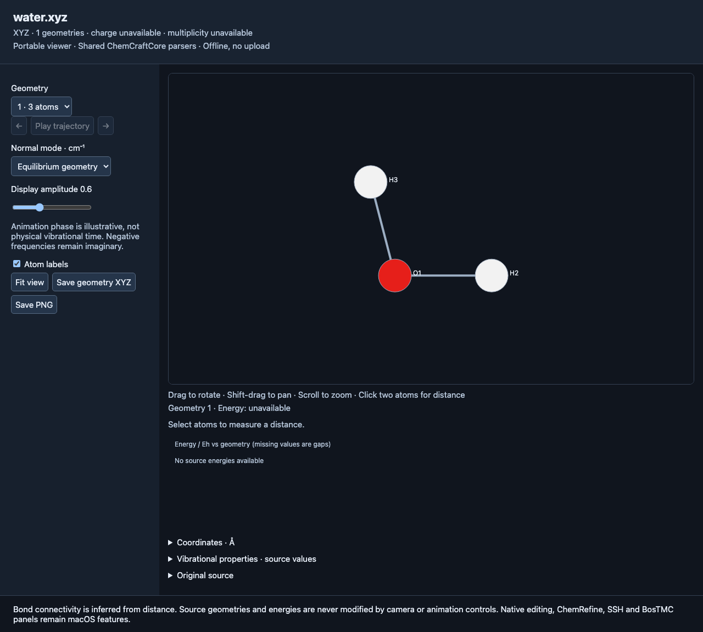
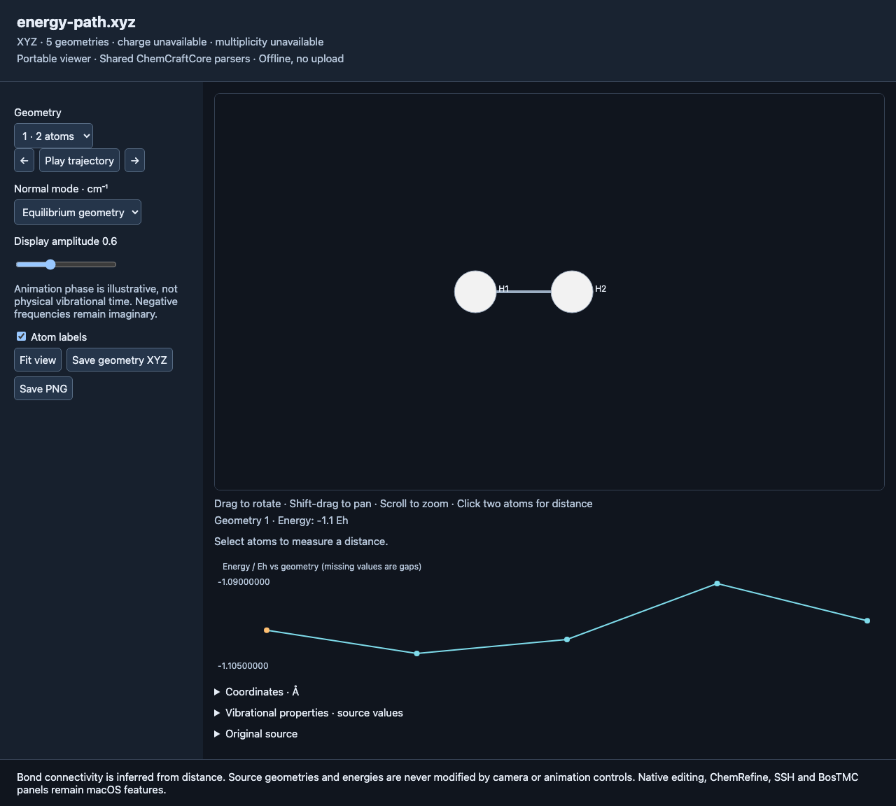
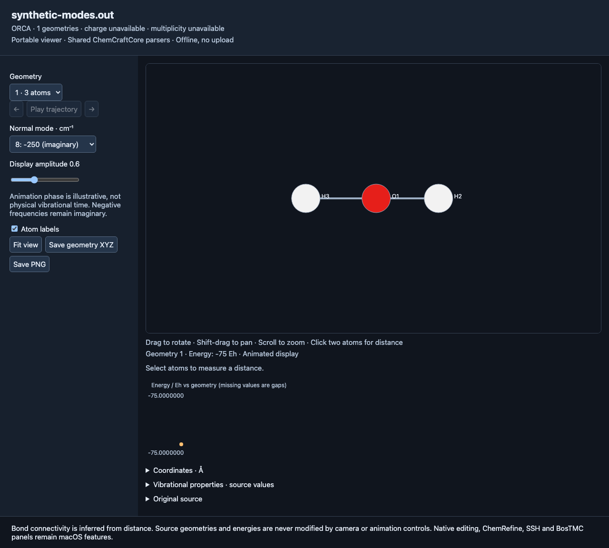

# Windows, Linux and macOS portable viewer

ChemViewer 0.12.0 adds a portable viewer alongside the native Mac application.
It uses the **same ChemCraftCore scientific parsers**, then writes a self-contained
HTML document that opens in a browser without a server or network access.
This is a portability preview ahead of 1.0, with a smaller interface than the Mac app.



## Build and open a molecule

Install Swift 6.1.3 and Python 3.12 for development checks. Windows also needs
the Visual Studio C++ and Windows SDK components required by the
[official Swift Windows installation instructions](https://www.swift.org/install/windows/).
Linux requirements are documented in the [Swift installation guide](https://www.swift.org/install/linux/).
The generated HTML itself needs only a current browser; Swift is needed to parse
new files and generate new documents. No Python runtime is required by the viewer.

On Linux or macOS:

```bash
swift build -c release --product ChemViewerPortable
.build/release/ChemViewerPortable Tests/fixtures/water.xyz --output water.html
# Open water.html in your browser (for example, xdg-open water.html on Linux).
```

On Windows, in a Swift-enabled PowerShell terminal:

```powershell
swift build -c release --product ChemViewerPortable
.build\release\ChemViewerPortable.exe Tests\fixtures\water.xyz --output water.html
Start-Process water.html
```

Keep the SwiftPM `.resources` or `.bundle` directory beside the executable when
moving a build. CI produces OS-specific preview ZIPs containing both. They require
the corresponding installed Swift runtime/toolchain; they are not standalone
installers. Linux x86_64, Windows x86_64 and macOS arm64 are the CI targets.
Linux arm64 is additionally tested locally in Docker.

Input paths with spaces should be quoted. Output paths must be new: the executable
refuses to overwrite any existing file, including its input. HTML contains the
source and scientific data, so share it with the same care as the original input.

## Supported workflow

1. Generate HTML from XYZ, ORCA output, ORCA input, or the Gaussian Cartesian
   geometry subset supported by the shared parser. ORCA `xyzfile` references are
   resolved relative to the input file's folder. Source-only input templates show
   their source without inventing a geometry.
2. Drag to rotate, Shift-drag to pan, scroll to zoom, and choose **Fit view** to reset.
   Click two atoms to measure their equilibrium distance in Å. Bonds are inferred
   from covalent radii, not read as bond orders.
3. Choose a geometry, use the arrows, or play the trajectory at 0.5 s intervals.
   The plot retains absolute Hartree values, and missing energies create gaps.
4. Select a normal mode. The viewer switches to its associated source frame.
   Negative frequencies remain negative and marked imaginary. Display amplitude
   changes only the illustrative animation; its phase is not physical time.
5. Expand Coordinates, Vibrational properties or Original source. IR source
   intensity and Raman activity remain separate; absent values say unavailable.
6. **Save geometry XYZ** exports the equilibrium geometry with the shared writer.
   **Save PNG** captures the current rendered canvas, including animation if active.
   PNG output size follows viewport size and device pixel ratio.



These figures use independently authored fixtures. Synthetic energies and modes
illustrate software behavior; they are not predictions for water.



## Data export

```bash
ChemViewerPortable calculation.out --json --output calculation.json
ChemViewerPortable trajectory.xyz --xyz --output exported.xyz
```

JSON schema version 1 declares coordinate and energy units, frames, source text,
source-format warnings, charge/spin when available, and vibrational properties.
It is an export boundary, not a project-file replacement. Cartesian coordinates
retain the core's Float precision; Hartree energies use Double. Missing optional
properties are omitted, never converted to zero. XYZ export includes every frame.

## Platform acceptance and remaining work

| Workflow | Native Mac app | Portable viewer |
|---|---|---|
| Shared XYZ/ORCA parsing; Gaussian geometry subset | Yes | Yes |
| Molecular display, source, geometry navigation, energies | Metal/native panels | Browser Canvas 2D projected view |
| Normal-mode animation, imaginary modes | Yes, optional arrows | Yes, no vector arrows |
| Measurements | Distance, angle, signed dihedral and persistent labels | Distance only |
| Geometry/project editing, builder, drawing, UFF | Yes | Pending |
| IR broadening, thermochemistry panels, NEB plot controls | Yes, bounded format support | Data subset only; no equivalent panels |
| High-resolution figure/animation exports | PNG, GIF, Matplotlib figures | Viewport PNG and XYZ/JSON |
| Remote explorer, SSH, ChemRefine, BosTMC panels | Yes, with documented external-service limits | Pending |
| Native desktop integration / installation | `.app`, file dialogs, document tabs | CLI generation plus browser opening |

All-platform CI runs core tests, migrated geometry suites, actual executable
regressions and Chromium acceptance. Browser tests are automated acceptance,
not physical Windows/Linux desktop certification. A 1.0 cross-platform release
still requires the missing workflows above, independent science fixtures, native
or equivalent desktop packaging, and physical display/input checks on all targets.
See [release gates](release-process.md) and [feature status](feature-parity.md).
