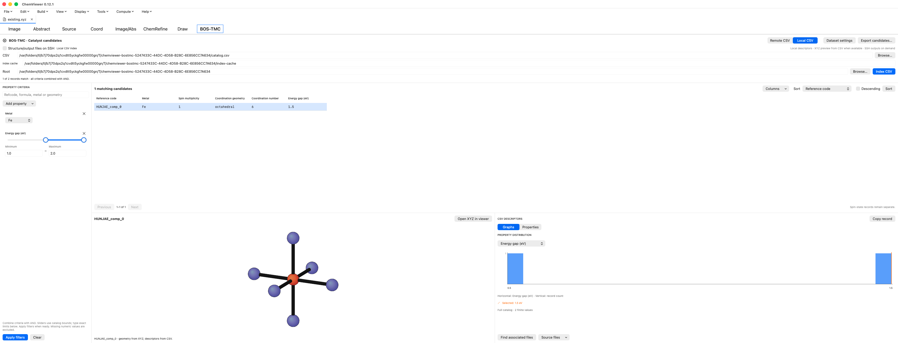
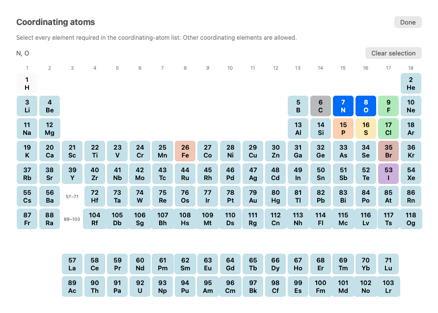

# ChemViewer feature guide

ChemViewer is an independent molecular visualization and computational chemistry
application. The native Mac app has the broadest workflow support; the new
[portable viewer](portable-viewer.md) provides a shared-parser viewing subset on
Windows and Linux. Version 0.12.0 is preparation for 1.0, not a full-parity claim.

## Open and organize calculations

On Mac, open XYZ trajectories, supported ORCA outputs/Cartesian inputs, Gaussian
geometry outputs, or saved `.cvproject`/compatible `.mvproject` structures.
Drag files into the application or use File → Open. Each document has its own
geometry, view, selection and undo state. Reopening the same source activates its
tab. Cmd-W closes the active document, with a guard for unsaved edits.

The left Result Explorer selects geometries and their associated modes. Arrow
keys browse geometries. Image shows the molecule; Abstract shows parsed facts;
Source retains original text; Coord edits coordinates; Image/Abs combines views.
Cmd-1 through Cmd-5 select these modes. ChemRefine is Cmd-6; Draw is Cmd-7.

An ORCA input with `* xyz` loads charge, multiplicity and Cartesian geometry;
`* xyzfile` explicitly resolves its companion. Internal-coordinate or template
inputs without supported Cartesian data remain source-only. Missing energies
and unsupported properties are never filled with guesses.

[Document isolation and file behavior](document-workspace-2026-10-21.md).

## Molecular display and measurements

Rotate by dragging (including Windows-style right dragging), Option-drag to pan,
and scroll to zoom. Choose a representation/appearance from Display or the toolbar.
The default Paton appearance uses the attributed xyzrender palette. Bonds are
inferred by distance; inferred connectivity is not a quantum bond-order analysis.

Click atoms in order. Two atoms expose a distance; three expose an angle; four
expose a signed dihedral. Right-click clears selection. Enable the measurement
label to annotate it. Persistent labels can coexist, move by dragging, and appear
in PNG/GIF exports. Visible labels lets you select/remove a label or hide all.
Distances are in Å, angles in degrees. Fragment selection depends on inferred
connectivity; ring bonds cannot be treated as a freely separable fragment boundary.

[Interaction and measurement evidence](measurements-and-smooth-drag-2026-10-19.md),
[persistent labels](drawing-and-labels-2026-10-20.md).

## Geometry editing and projects

Coord accepts element symbols or atomic numbers and Cartesian coordinates.
Apply commits the draft. Bond-length/angle controls support the movement choices
shown in their inspector. Atom/Fragment/Molecule manipulation supports translation
and rotation about a chosen pivot. Edits invalidate source energies for modified
geometries; Undo restores the prior geometry and associated provenance.

Use New Molecule, Build → Add Atom (Cmd-Shift-A), or the fragment gallery (Cmd-B).
Choose a fragment and click blank space to place it or a host atom to attach it;
right-click finishes. Cmd-Shift-B opens editing/UFF controls. Save reusable
fragments from a selection. Dummy X sites describe attachment points and must be
removed or resolved before a calculation. Save a project to retain editable
structure state; export XYZ or ORCA Cartesian geometry for other programs.

The local optional chemistry runtime supplies RDKit/UFF cleanup, with fixed-atom
support. UFF is a molecular mechanics cleanup, not a quantum optimization.

[Builder setup and limits](building-and-local-workflows.md),
[integrated project behavior](moleculeview-integration-2026-10-19.md).

## Draw molecules and generate 3D structures

Draw provides bond, element, move, erase, formal-charge, SMILES and ring tools.
Chain draws a zigzag alkane as one undoable action. More rings offers 14 explicit
ring templates, including common heterocycles. Auto 3D preview uses local RDKit;
Generate 3D triggers it manually. Invalid valences show an error; correction can
retry. Use 3D in Viewer transfers a valid generated structure as an undoable edit.
A stale or failed preview cannot be transferred. Save drawing drafts as JSON.

[Drawing workflow](drawing-and-labels-2026-10-20.md),
[ring and skeletal tools](skeletal-drawing-2026-10-20.md).

## Vibrations and spectra

Select an ORCA normal mode to animate its associated source geometry. Optional
vectors show printed Cartesian displacements. Negative frequencies remain
negative and are marked imaginary; display amplitude and animation rate are
visual controls, not IR intensity or physical vibrational time.

IR provides sticks and Gaussian/Lorentzian broadening for supported output tables.
IR source intensity and Raman activity are distinct quantities. Raman spectrum
conversion and full vibrational-format parity are not implemented. Source values
and their documented format units remain authoritative.

[Scientific validation and fixtures](scientific-validation.md).

## Energies, thermochemistry and reaction profiles

Abstract links parsed ORCA energy records to their source sections and displays
available E/H/G and electronic-plus-thermal sums. Choose the source unit explicitly
for unitless XYZ energy comments. Stored electronic energies remain in Hartree;
display conversions are explicit. Missing corrections do not become zero.

Energy landscape produces absolute/relative profiles, optional distance/angle
axes and structures, with vector PDF/SVG, high-resolution PNG, CSV and a reproducible
script. Install the plotting runtime using `bash scripts/setup-plotting.sh`.
ORCA NEB-TS has a bounded summary parser and reaction-profile view with printed
reactant/TS/product values and barriers. This does not imply complete IRC/PES/NEB
support across programs or justify subtracting energies from unlike methods.

[Energy and editing workflow](energy-and-editing-2026-10-19.md),
[thermochemistry](thermochemistry-and-manipulation-2026-10-19.md),
[NEB profiles](neb-reaction-profiles-2026-10-19.md).

## Export figures, structures and animations

Use the camera control for the current PNG; coordinate copy controls offer XYZ
or coordinate text. File → Export Animation as GIF exports a trajectory or mode
using the current view and fixed animation bounds. Size, frame rate, playback
speed and forward/backward trajectory controls are explicit. Labels can be included.
GIF transparency is binary; it cannot preserve fractional edge alpha.

[Appearance, animation and export limits](paton-and-gif-2026-10-19.md).

## ChemRefine local calculations

Install the optional runtime with `bash scripts/setup-chemistry.sh`. ChemRefine's
editor creates or opens `input.yaml`, saves form/template drafts, checks installed
engines and launches a detached workflow. Review resources, methods and paths
before running. Use Check workflow, Create missing templates and Install required
backends where appropriate. ORCA and model weights require their own authorized
installation; ChemViewer does not bundle them.

Run and Resume share the readiness/save checks. The dashboard reports saved
step status, engine, result count and reported energy, with explicit unit controls.
Retained results without a valid successful cache are marked previous. Resume
uses existing cache; targeted recovery actions are distinct from a fresh run.
UMA Python settings select the environment used by relevant MLIP steps and preserve
explicit per-step overrides. Closing an editor does not kill detached calculations.

[Execution guide](chemrefine-execution-2026-10-20.md),
[dashboard](chemrefine-dashboard-2026-10-20.md),
[UMA environment](uma-environment-settings-2026-10-20.md).

## SSH files and remote workflows

File → Remote files & SLURM manages connection profiles. Authenticate interactively
in Terminal. Browse uses a persistent helper/cache; Refresh re-reads remote contents.
The explorer supports parent/home, folder expansion, double-click navigation and
Name/Extension ordering. Opened scientific files pass through the same native
parser. Source hashes protect downloaded content and changed-file edits.

Select an authenticated SSH destination in ChemRefine to open/create remote
workflows. Relative files and `dispatch: slurm` are checked before submission.
Save drafts explicitly; status refresh does not save them. Existing detached jobs
and shared SSH masters survive editor closure. Passwords are not stored in profiles.

The 0.11.2 investigation reproduced trivial-command/SFTP stalls outside the app;
authentication alone is not evidence that the remote service is usable. Actual
cluster chemistry completion is still a separate acceptance gate.

[Remote setup](remote-connections-2026-10-20.md),
[shared destination](remote-connections-2026-10-20.md).

## BOS-TMC catalyst screening

The native screenshot uses two independently authored synthetic spin records,
not production BOS-TMC data or a calculated catalyst ranking.

Choose **BOS-TMC**, then a local CSV or SSH source, a structure/output root and
optionally an index cache. A local downloaded catalog can filter and preview its
embedded XYZ without SSH; enable remote structure/output lookup only when needed.
Indexing is streamed into a compact SQLite cache and leaves the CSV unchanged.
Keep that CSV available: large raw fields are read from source offsets on demand.

In **Add property → Coordination geometry → Coordinating atoms**, open the
periodic-table dropdown and select the donor elements you require. Click elements
to toggle them, then **Done** and **Apply filters**. Selecting N and O matches
records whose declared `coordinating_atoms` list contains **both** elements;
additional donors such as S are allowed. N never matches Na. This is element
presence, not a request for a particular count of each element. Missing or invalid
donor lists do not match; no donors are inferred from the formula or XYZ.

Coordination-number dropdown options and table sorting use numeric order
(0, 1, 2, …, 10, 11), preserving the original CSV values. Re-index the CSV once
for 0.12.1's donor-element index; existing caches and the source CSV are retained.

Apply combines criteria with AND semantics. Scalar ranges support one-sided
bounds; categories come from the catalog. Array any/all/mean have distinct meanings.
Missing/nonfinite numeric values are excluded from range queries. Columns, numeric
sorting, paging and CSV export retain raw source properties and precision.

Select a row to inspect full properties, histogram, α/β orbital descriptors and
dipole components. Histograms cover the finite full catalog, not just the visible
page. Select an associated XYZ when multiple choices exist. Open in Viewer carries
valid CSV charge/spin; separate spin records remain separate documents. Psi4 output
is source inspection, not a claim of complete Psi4 result parsing. Filtering
selects records; it does not establish catalytic activity.

[Screening implementation and acceptance](../README.md#bos-tmc-catalyst-screening--0110),
[local catalog and graph validation](scientific-validation.md#local-bostmc-actual-catalog-validation--0111--build36-2026-10-22).

## Supported scope and troubleshooting

Use [the platform matrix](portable-viewer.md#platform-acceptance-and-remaining-work)
and [feature status](feature-parity.md) for limitations. Cube/MO/density surfaces,
full Raman/TDDFT/NMR and comprehensive chemistry-program compatibility remain
unimplemented. Every new scientific parser needs a redistributable fixture and
independent numerical oracle.

A blank or failed renderer should report its error; collect build/runtime evidence
rather than treating a launched window as a pass. On Mac, build and install using
`bash scripts/install-macos.sh`; quit and reopen to use the updated installation.
Reproducible testing and release requirements are in [the release guide](release-process.md).
